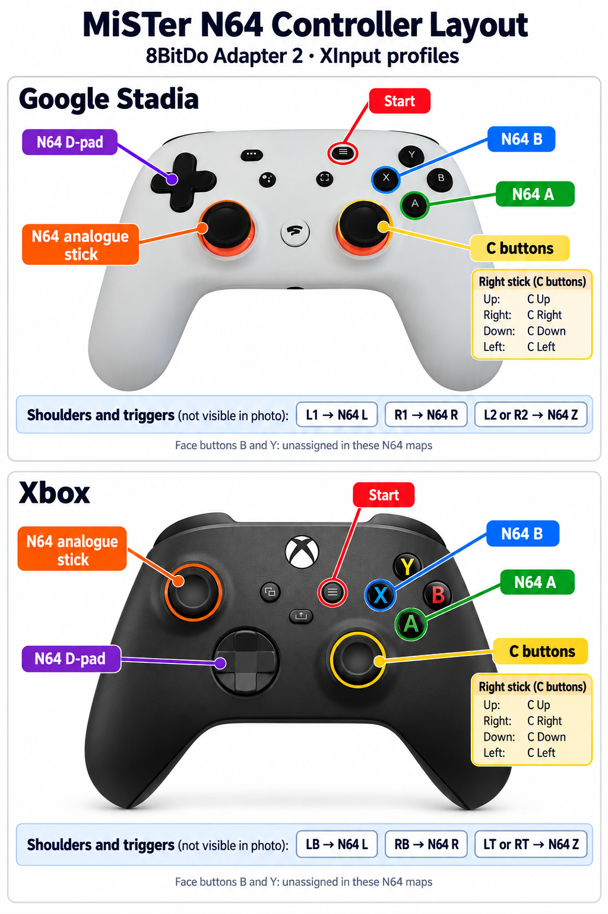

# MisterFPGA 8BitDo Selector

Choose the controller paired with an **8BitDo USB Wireless Adapter 2** and apply its saved MiSTer button mappings.

The receiver presents the same USB identity for different paired controllers within a USB output mode. MiSTer therefore shares their mapping filenames. This script asks you to choose the physical controller and installs its main-menu and core maps.

**Version 0.3.1 adds a program updater and controller navigation for XInput and Switch output modes.** Use the D-pad to move and Start to select, including capture and undo prompts. It detects the receiver's USB mode, not the paired controller. Automatic prompting on pairing is still planned.

## Included profiles and test results

Each included profile contains a main-menu map and an N64 core map. All 12 maps are actual 128-byte MiSTer v3 files captured on a MiSTer Multisystem 2.

| Controller | Switch maps (`057e:2009`) | XInput maps (`2dc8:3106`) | XInput rumble in this setup |
| --- | --- | --- | --- |
| N64 controller with 8BitDo Bluetooth mod | Included | Included, controls tested | No response to CLI strong/weak rumble tests |
| Google Stadia | Included | Included, controls tested | No rumble observed in the core test |
| Xbox | Included | Included, controls tested | Working in the N64 core |
| PS4 | Not captured | Not captured | Not tested |

These are results from this receiver/controller setup, not a claim that every controller model or firmware behaves the same way. The modified N64 pad pairs in **S Bluetooth mode** while the receiver presents **XInput** to MiSTer. The pad's Bluetooth mode and the receiver's USB output mode are separate settings.

## N64 controller layout

The Xbox and Stadia XInput profiles use the layout shown below. Both triggers are mapped to N64 Z; the right stick supplies the four C buttons.



[Open the full-size layout sheet](docs/images/n64-xinput-layout.png).

## Requirements

- MiSTer with Bash and its usual shell utilities.
- An 8BitDo Adapter 2 presenting as `057e:2009` (Switch) or `2dc8:3106` (XInput).
- Standard VID/PID mapping filenames. Per-port unique mapping configurations are not supported.
- A paired pad with a D-pad and Start button for controller navigation. A keyboard or SSH connection provides a fallback.

Switch and XInput profiles use different input layouts. **Do not rename a Switch map to make it an XInput map.** Configure and capture each mode separately.

## Install or update

1. Download this repository using GitHub's **Code > Download ZIP**.
2. Extract it and copy the project folder to MiSTer using WinSCP or another file transfer tool.
3. Over SSH, change into that folder and run:

```bash
bash install.sh
```

The installer copies the selector and its bundled ARM helper into `/media/fat/Scripts/` and profiles into `/media/fat/config/8bitdo-profiles/`. It preserves active maps and backs up an existing different selector before replacing it. It checks all bundled profiles first and stops if an existing bundled map differs. Preserve or move the conflicting map before retrying; custom additional core maps are retained.

Existing v0.1.0 Switch profiles stay in their original directories. XInput profiles are installed separately:

```text
config/8bitdo-profiles/n64/
config/8bitdo-profiles/stadia/
config/8bitdo-profiles/xbox/
config/8bitdo-profiles/xinput/n64/
config/8bitdo-profiles/xinput/stadia/
config/8bitdo-profiles/xinput/xbox/
```

## Updating the program

After installation, open **Scripts > 8BitDo_Selector_Update**. It downloads the
latest selector, controller navigation helper and updater from `main`.
It pins all downloads to one commit, checks their SHA-256 hashes and shell
syntax, backs up the installed program files, then replaces them. A failed
or interrupted installation attempts to restore the previous files.

**Updates preserve every saved profile, active map and selector undo record.**
Customising a bundled profile does not block a program update. Updates do
not install new profiles or change existing ones. The original full installer
still checks bundled profile conflicts.

From SSH:

```bash
bash /media/fat/Scripts/8BitDo_Selector_Update.sh --no-pause
```

If you have an older version without the updater, download it once to a
scratch file and run it. The updater installs itself alongside the selector:

```bash
curl -fL --proto '=https' https://raw.githubusercontent.com/Soopahfly/MisterFPGA-8BitDo-Selector/main/Scripts/8BitDo_Selector_Update.sh -o /tmp/8BitDo_Selector_Update.sh
bash /tmp/8BitDo_Selector_Update.sh --no-pause
```

Run the second command only if the download succeeds. Internet access and
`curl` are required for online updates. There is no background update service.
Checksums detect download corruption; the package and manifest are obtained
from the same repository over HTTPS.

For an offline update, download/extract the latest ZIP and run inside its folder:

```bash
bash install.sh --program-only
```

This uses the same verified updater without downloading or checking profiles.
`UPDATE_SOURCE_DIR=/path/to/extracted/project` supplies a local package directly.
Program backups are stored in `config/8bitdo-profiles/program-backup-*/` with
paths relative to `/media/fat`. If already current, no new backup is made.
The updater shares the selector/installer lock. Updates from Scripts can be
finished with Start on a paired pad, or Enter on a keyboard.

## Use

1. Pair your controller and open **Scripts > 8BitDo_Controller_Selector**, or run:

```bash
bash /media/fat/Scripts/8BitDo_Controller_Selector.sh
```

2. The script detects the receiver's USB mode from its gamepad input. If disconnected or ambiguous, choose the mode matching the adapter's USB output.
3. Use **D-pad up/down** to highlight **N64**, **Stadia** or **Xbox**, then press **Start**. Keyboard arrows and Enter also work. Choose Exit to cancel, or press Esc on the keyboard.
4. Exit the script, turn the controller off and reconnect it. Press a button in the core to assign the player, if needed.

You can also select a profile before pairing. Choosing a mode in this script selects saved mapping files; it does **not** change the adapter's hardware mode.

MiSTer caches loaded mappings. Re-pairing when changing controllers provides the reconnect step in the tested setup. If the input device remains present after switching the pad off, unplug/replug the receiver.

The recorded **last selected** profile is a saved label for that USB mode. It does not identify the connected physical controller. The receiver's keyboard, mouse and Switch IMU interfaces are ignored during mode detection.

## Controller navigation

The menu reads the receiver's raw Linux input events. It does not depend on the MiSTer profile currently applied. Start is used for selection because the N64 mod and Xbox/Stadia face buttons have different raw layouts. Analogue sticks and face buttons do not navigate this version.

You can use the working pad to open Scripts, select the next pad's profile, finish with Start, then turn the old pad off and pair the new one. You can also navigate with the newly paired pad even when its MiSTer mappings are wrong, provided you can open the script using a keyboard or SSH.

The helper discovers the gamepad interface dynamically, ignores the receiver's keyboard/mouse and Switch IMU interfaces, and rechecks for a reconnected receiver. It temporarily grabs the gamepad while a menu is open to keep those presses out of MiSTer, and releases it on exit. A held Start button must be released and pressed again before accepting the next screen. An unavailable or busy gamepad leaves keyboard controls available.

The bundled helper is a static ARMv7 hard-float executable in `Scripts/.8bitdo-selector/controller-menu`. No compiler, Python or extra packages are needed on MiSTer. Install the whole package to get it. If the helper is missing or cannot run, the selector falls back to its numbered keyboard menu. SSH arrow/Enter controls also work; a non-interactive/piped session retains the original numbered interface. `NAV_HELPER=/path/to/helper` overrides the helper for development.

## Other cores and additional profiles

Try the default layout first. If a core needs changes:

1. Apply the correct profile and reconnect the controller.
2. Map its buttons inside that core and test them.
3. Return to the selector and choose **Capture current maps into a profile**.
4. Select the controller, then choose **Save current maps**. In the keyboard-only fallback, enter `n64`, `stadia`, `xbox` or `ps4` and confirm with `yes`.

Capture saves the active standard global/core v3 maps for the selected USB mode and backs up the previous profile. Make sure the correct profile is active before remapping, otherwise another controller's core maps could be captured with it. Capture does not change the active maps or the undo pointer.

PS4 can be added when a pad is available for configuration and testing. Until then, selecting PS4 reports a missing profile and leaves active maps alone.

For the main menu's SNES-style button prompts, Stadia/Xbox physical positions are: MiSTer B = physical A, A = B, Y = X, X = Y. Core-specific mappings are configured separately.

## Backups and undo

Applying a profile backs up the active maps for that USB mode, verifies staged copies, removes stale standard core overrides for that identity, then installs the selected maps. Failed/interrupted map installation attempts to restore the previous map set. Undo also handles an originally empty map set.

| USB mode | Profiles, state and backups |
| --- | --- |
| Switch | `/media/fat/config/8bitdo-profiles/` |
| XInput | `/media/fat/config/8bitdo-profiles/xinput/` |

Choose **Undo last selector switch** to restore the maps active before the last successful selection in the current mode. Switch and XInput have independent undo pointers. Both modes and the installer share a lock to prevent concurrent writes. Capture backups do not replace the undo pointer.

Only standard global/core v3 maps for the selected identity are managed. Advanced maps, keyboard maps, other USB identities, boot settings and services are left alone. Other hardware with the same VID/PID also shares those filenames, including genuine Switch Pro controllers in Switch mode and other 8BitDo devices presenting as `2dc8:3106`.

## SSH commands

With a paired receiver, USB mode is detected automatically:

```bash
bash /media/fat/Scripts/8BitDo_Controller_Selector.sh status
bash /media/fat/Scripts/8BitDo_Controller_Selector.sh apply n64
bash /media/fat/Scripts/8BitDo_Controller_Selector.sh capture n64 --yes
bash /media/fat/Scripts/8BitDo_Controller_Selector.sh restore
```

When disconnected, specify the mode before the command:

```bash
bash /media/fat/Scripts/8BitDo_Controller_Selector.sh --mode xinput apply xbox
bash /media/fat/Scripts/8BitDo_Controller_Selector.sh --mode switch status
```

An explicit mode conflicting with a single detected mode is rejected. If both identities are present, automatic commands stop and require an explicit mode. The selector cannot distinguish multiple receivers or a genuine controller sharing the same identity.

## Validation and limits

- Switch Scripts-menu operation and an Xbox-to-N64 profile switch were tested on MiSTer Multisystem 2 with v0.1.0.
- All three XInput controllers were configured and tested on the same machine. Xbox rumble worked; N64-mod and Stadia tests did not produce rumble.
- The v0.2.0 selector passes local file-operation tests for both modes, mode detection, offline menu choice, stale override removal, independent undo, capture, other-device and advanced-map preservation, missing/corrupt profiles, installer conflicts, locks and simulated failure rollback.
- The updater passes local and mocked HTTPS tests for profile preservation, checksum/download rejection, commit pinning, repeat updates and rollback. Online downloading on MiSTer still needs testing.
- Controller navigation passes native terminal and input-translation tests, but the bundled ARM helper and physical D-pad/Start operation still need testing on MiSTer. The updated selector still needs a hardware switching test. Portability to a second MiSTer, other cores and PS4 remain untested.

Run the checks on a Linux computer with Bash, Python 3 and GCC (for the native navigation tests):

```bash
python3 tests/test_selector.py
python3 tests/test_navigation.py
python3 tests/test_updater.py
```

Tests use temporary directories and never write to a real MiSTer configuration.

To rebuild the bundled helper on a Linux development machine with an ARM hard-float musl cross toolchain (including Linux headers) installed:

```bash
bash src/build.sh
```

The default tools are `arm-linux-musleabihf-gcc` and `arm-linux-musleabihf-strip`; override them with `CC` and `STRIP`. `CPPFLAGS` can supply a Linux header path when building a musl wrapper toolchain. The build script updates the binary checksum checked by the installer. After changing any distributed program file, run `bash update/build-manifest.sh` to refresh the updater manifest. The helper source is in `src/controller-menu.c`.

The bundled helper links musl 1.2.4 and GCC 13 runtime code. Their notices are in `src/licenses/`; build details are in `src/BUILD.md`.

## Planned improvements
- A selection prompt when the receiver's gamepad input appears. Integration with MiSTer's display and input handling still needs investigation.
- PS4 mappings, more core mappings and a second-MiSTer portability test.

## Reporting a problem

Open an issue with the controller model, adapter mode/firmware, MiSTer kernel (`uname -r`), selected profile, affected core and steps to reproduce. Include the selector's error and `status` output. Do not include passwords or a full login transcript.
